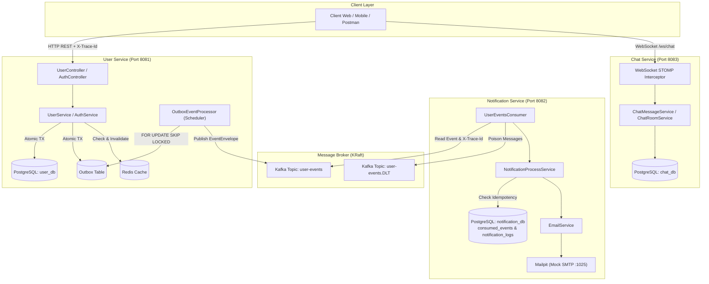
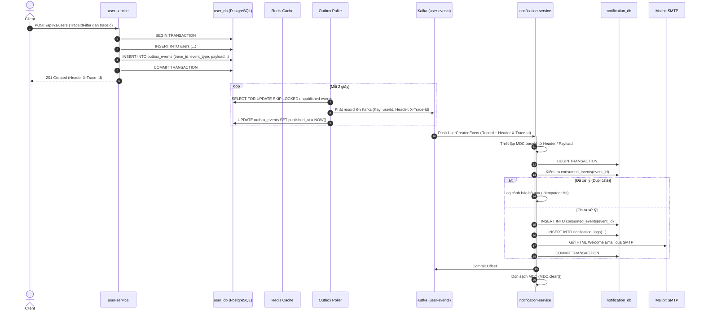

# 🏛️ Architecture Documentation — Microservice Platform

Tài liệu thiết kế kiến trúc kỹ thuật toàn diện cho hệ thống **Microservice Platform: User & Notification & Chat System**.

---

## 1. Tổng Quan & Nguyên Tắc Thiết Kế (Design Principles)

Hệ thống được xây dựng tuân thủ nghiêm ngặt các nguyên tắc kiến trúc Microservice hiện đại:

1. **Database-per-Service (Cơ sở dữ liệu độc lập)**:
   - Mỗi microservice sở hữu schema database riêng biệt (`user_db`, `notification_db`, `chat_db`).
   - Tuyệt đối **không** chia sẻ kết nối cơ sở dữ liệu hay thực hiện Cross-Database Query/Join giữa các service.
2. **Event-Driven Architecture (EDA) & Bất đồng bộ**:
   - Giao tiếp liên dịch vụ khi có thay đổi trạng thái diễn ra qua **Apache Kafka** với mô hình publish/subscribe.
   - Các dịch vụ hoàn toàn loose-coupled (tách rời), không gọi REST đồng bộ trực tiếp khi xử lý tác vụ thông báo.
3. **Transactional Outbox Pattern**:
   - Đảm bảo tính nguyên tử (Atomicity) giữa thao tác ghi dữ liệu nghiệp vụ vào Database và việc phát sự kiện lên Kafka.
   - Loại bỏ nguy cơ "Dual-Write Problem", đảm bảo tính phân tán **At-Least-Once Delivery** không bao giờ thất lạc tin nhắn.
4. **Idempotent Consumer & Dead Letter Topic (DLT)**:
   - Consumer tại `notification-service` duy trì bảng `consumed_events` có khóa chính `event_id` để ngăn chặn xử lý lặp khi Kafka rebalance hoặc retry.
   - Cơ chế retry thông minh với Dead Letter Topic (`user-events.DLT`) bảo vệ hệ thống khỏi Message Poisoning.
5. **End-to-End Distributed Tracing**:
   - Mỗi luồng HTTP request được gán hoặc tiếp nhận một `traceId` duy nhất.
   - `traceId` được gắn vào MDC logging, truyền qua Kafka header & payload, cho phép theo vết toàn bộ chuỗi hành động qua nhiều service chỉ bằng một mã duy nhất.

---

## 2. Sơ Đồ Kiến Trúc Tổng Thể (System Architecture)

---

## 3. Phân Rã Các Module (Module Breakdown)

### 3.1. `common-lib`
- **Mục đích**: Thư viện dùng chung cung cấp các tiêu chuẩn thống nhất cho toàn bộ hệ sinh thái microservice.
- **Thành phần cốt lõi**:
  - `EventEnvelope<T>`: Cấu trúc đóng gói sự kiện chuẩn gồm `eventId`, `eventType`, `aggregateId`, `traceId`, `timestamp`, `payload`.
  - `UserCreatedEvent`, `UserUpdatedEvent`, `UserDeletedEvent`: Schema dữ liệu các sự kiện miền.
  - `ErrorResponse`, `PageResponse`: Chuẩn hóa phản hồi API nhất quán.
  - `BusinessException`, `ErrorCode`: Quản lý lỗi nghiệp vụ tập trung.

### 3.2. `user-service`
- **Trọng trách**: Quản lý tài khoản, hồ sơ người dùng, xác thực bảo mật và phát sự kiện.
- **Công nghệ**: Spring Boot 3.4.3, Spring Data JPA, Spring Security, JWT (HMAC-SHA256), Redis, Flyway, PostgreSQL.
- **Đặc điểm nổi bật**:
  - Mã hóa mật khẩu bằng BCrypt (rounds 12).
  - Quản lý Access Token (15 phút) và Refresh Token xoay vòng (Rotation) được băm SHA-256 lưu trữ an toàn trong DB.
  - Bộ đệm Redis đa tầng (`@Cacheable`, cache user profile, chống brute-force đăng nhập).
  - Outbox Scheduler polling bằng câu lệnh an toàn đa luồng `SELECT ... FOR UPDATE SKIP LOCKED`.

### 3.3. `notification-service`
- **Trọng trách**: Lắng nghe sự kiện người dùng, gửi email chào mừng, quản lý lịch sử thông báo.
- **Công nghệ**: Spring Kafka, Spring Data JPA, JavaMailSender, Thymeleaf / HTML Template, Flyway, PostgreSQL.
- **Đặc điểm nổi bật**:
  - Idempotent Consumer: Mỗi `eventId` chỉ được xử lý đúng một lần duy nhất.
  - Dead Letter Topic (`user-events.DLT`): Chứa các message không hợp lệ hoặc lỗi phân tích cú pháp để điều tra độc lập.
  - Mock SMTP qua Mailpit phục vụ kiểm thử gửi email trực quan mà không phụ thuộc vào hạ tầng bên ngoài.

### 3.4. `chat-service`
- **Trọng trách**: Cung cấp tính năng trò chuyện thời gian thực cho người dùng và quản trị viên.
- **Công nghệ**: Spring WebSocket, STOMP Protocol, Spring Data JPA, Flyway, PostgreSQL.
- **Đặc điểm nổi bật**:
  - Channel Interceptor thẩm định JWT Token ngay tại thời điểm bắt tay (Handshake STOMP CONNECT).
  - Lưu trữ lịch sử tin nhắn phòng chat và cập nhật trạng thái đã đọc.

---

## 4. Luồng Dữ Liệu Chi Tiết: Đăng Ký & Phát Sự Kiện (Choreography Sequence)

---

## 5. Cơ Chế Quan Sát Hệ Thống (Observability & Tracing)

- **Trace ID Propagation**:
  1. `TraceIdFilter` trong `user-service` đón nhận header `X-Trace-Id` từ client hoặc sinh mới UUID chuẩn.
  2. Giá trị này được nạp vào SLF4J MDC: `MDC.put("traceId", traceId)` và gán ngược lại response header `X-Trace-Id`.
  3. `OutboxServiceImpl` ghi `traceId` vào cả trường `trace_id` của bảng outbox lẫn metadata `EventEnvelope`.
  4. `OutboxEventProcessor` inject header Kafka `X-Trace-Id` khi gửi tin nhắn.
  5. `UserEventsConsumer` trích xuất `traceId` từ Kafka header hoặc JSON payload và nạp vào MDC của thread xử lý.
  6. Mọi câu log của cả hai service đều xuất hiện prefix `[%X{traceId:-}]`.
- **Health & Metrics Monitoring**:
  - `/actuator/health`: Cung cấp thông tin chi tiết về tính sẵn sàng của PostgreSQL, Redis, Disk Space, Mailpit.
  - `/actuator/metrics`: Cung cấp số liệu thống kê JVM, Garbage Collection, luồng HTTP request, Kafka lag.

---

## 6. Bảo Mật Hệ Thống (Security Architecture)

- **Mật khẩu**: Băm bằng `BCryptPasswordEncoder` với hệ số làm việc 12, không thể giải mã ngược.
- **Bảo mật phản hồi lỗi**: Lỗi sai mật khẩu hoặc tài khoản không tồn tại đều trả về thông điệp chung `Email hoặc mật khẩu không chính xác` để chống thu thập tài khoản (User Enumeration Attack).
- **Ngăn chặn XSS & Injection**:
  - Validate định dạng DTO nghiêm ngặt bằng Jakarta Validation (`@NotBlank`, `@Email`, `@Pattern`).
  - Dữ liệu tên người dùng hiển thị trên email được escape ký tự HTML đặc biệt (`HtmlUtils.htmlEscape`).
- **Container Isolation**:
  - Các Docker image chạy dưới quyền `appuser` (UID 1001), ngăn chặn triệt để đặc quyền `root` trên host system.
